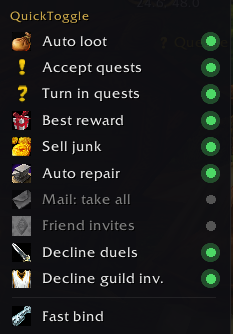
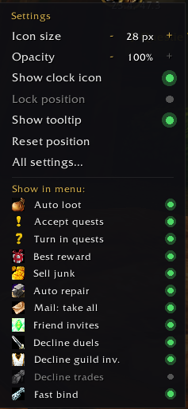

# Timesaver

One small clock icon for **World of Warcraft: Forever** (interface 16001)
that switches everyday chores on and off: looting, quests, vendors, mail and
unwanted social requests.

 

## Features

| Feature | What it does |
|---|---|
| Auto loot | Takes everything from the loot window at once. |
| Accept quests | Accepts quests from NPCs, gossip menus, quest boards and escort quests. |
| Turn in quests | Completes finished quests; stops when a reward has to be chosen. |
| Best reward | Picks the quest reward that sells for the most. |
| Sell junk | Sells grey items when a vendor window opens. |
| Auto repair | Repairs everything at vendors who can repair. |
| Mail: take all | Adds a "Take all" button to the mailbox (letters with COD are skipped). |
| Friend invites | Accepts group invites from friends and guild members. |
| Decline duels / guild invites / trades | Declines them from players who are neither friends nor guild members. |

**Hold Shift** while looting, talking to an NPC or opening a vendor to skip the
automation once. Every feature is off until you switch it on.

## Clock icon

- **Left click** – menu with all features and the **Fast bind** button
  (opens key bindings).
- **Right click** – quick settings: icon size and opacity, show/lock the
  icon, tooltip, reset position, and which features are listed in the menu.
- Drag to move. The ring turns gold while at least one feature is on.

Also available:

- **Options page:** Esc > Options > AddOns > Timesaver.
- **Key bindings** for every feature: Esc > Options > Keybindings > AddOns.
- **Titan Panel** (and other LibDataBroker displays): a Timesaver button
  with the same menus; the floating clock can then be hidden.

## Commands

| Command | Action |
|---|---|
| `/tsv` | Show or hide the clock icon |
| `/tsv options` | Open the options page |
| `/tsv lock` | Lock or unlock the icon position |
| `/tsv reset` | Move the icon back to the center of the screen |
| `/tsv help` | Print the command list |

## Languages

English, Russian.

## Development

- The repository root is the addon folder. For local testing, link it into
  the game (adjust the game path):
  `mklink /J "<WoW>\_forever_beta_\Interface\AddOns\Timesaver" "<this repo>"`
- `tools\render-icon.ps1` redraws the clock texture `Media\icon.tga`.
- `build.ps1` builds `dist\Timesaver-<version>.zip` locally.
- Releases: update `CHANGELOG.md`, then push an annotated tag
  (`git tag -a v1.0.1 -m "v1.0.1"` and `git push --tags`). GitHub Actions runs
  the BigWigs packager, which uploads the zip to CurseForge and GitHub Releases.
